# 🐾 pawsee

Cute animated little people that show what your **GitHub Copilot CLI**, **Claude Code**, **Codex CLI** and **Gemini CLI** agents are doing.
One card per agent: a hand-drawn character with a stick body that acts out the work (walking, running, squatting, jumping…),
what it's doing right now, and what it just did.

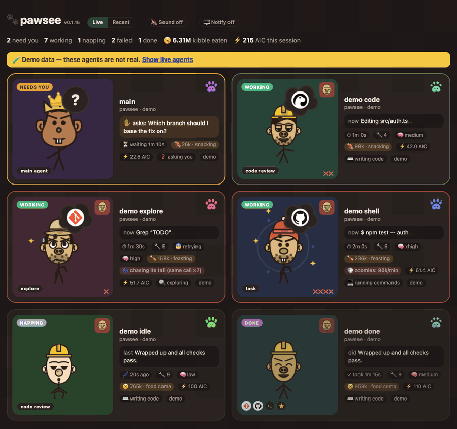
*The `?demo` page: sample agents in every state (waving, walking, running, squatting, jumping). [Still image](docs/screenshot.jpg).*

pawsee only **reads** the session logs they already write: `~/.copilot/session-state` for Copilot CLI, `~/.claude/projects` for Claude Code,
`~/.codex/sessions` for Codex CLI and `~/.gemini/tmp` for Gemini CLI. Each tool gets its own little paw in the corner of the card: round beans for Copilot, claws for Claude Code,
blocky square toes for Codex and little sparkles for Gemini. (Point pawsee elsewhere with `--dir`, `--claude-dir`, `--codex-dir` and `--gemini-dir`.)

> **Gemini CLI support is experimental.** It was written from other tools' notes on the log format, not from a live Gemini session, and it
> doesn't read sub-agent files or the older single-file `session-*.json` logs. If your logs differ, pawsee shows its "can't make sense of some
> logs" banner. Please [open an issue](https://github.com/henskjold73/pawsee/issues) with what you see. Codex support was built against real logs.
> Codex and Gemini have no process registry, so a session counts as live while its log is being written, and the card can't jump to its terminal.
The page is served on `localhost` only, and none of your session data leaves your machine.
The one network request pawsee makes is a plain check of GitHub's "latest release" at start-up and every 6 hours, to show a small "update available" note (it sends nothing but a User-Agent of `pawsee-update-check`). Turn it off with `--no-update-check` or `PAWSEE_NO_UPDATE_CHECK=1`.

## Install

**macOS / Linux** — no Node needed:

```sh
curl -fsSL https://raw.githubusercontent.com/henskjold73/pawsee/main/install.sh | sh
```

**Windows** (PowerShell) — no Node needed:

```powershell
irm https://raw.githubusercontent.com/henskjold73/pawsee/main/install.ps1 | iex
```

Then run `pawsee`. It opens <http://localhost:4747> in your browser. Leave it open next to your terminal
and start a Copilot CLI session. The installers fetch the latest [release](https://github.com/henskjold73/pawsee/releases),
check its SHA-256 checksum, and put `pawsee` in `~/.local/bin` (macOS/Linux) or `%LOCALAPPDATA%\pawsee` (Windows).

**With Node 18+** (any OS) you can skip the download:

```sh
npx @horrible73/pawsee
# or install once (the command is still just `pawsee`):
npm install -g @horrible73/pawsee
```

(`npx github:henskjold73/pawsee` and `npm install -g github:henskjold73/pawsee` also work, straight from this repository.)

**Manual download:** grab the file for your system from the [releases page](https://github.com/henskjold73/pawsee/releases).
The binaries aren't code-signed, so a browser download will be flagged: on macOS run
`xattr -d com.apple.quarantine pawsee` once; on Windows choose *More info → Run anyway* in SmartScreen.
(The one-line installers above don't trigger either warning.)

### "pawsee" is not recognized / command not found

- **Windows, after the PowerShell installer:** the PATH change only reaches *new* terminals, and the latest installer also updates the
  window you ran it in. If you installed with an older copy, open a new PowerShell window, or run it by its full path:
  `& "$env:LOCALAPPDATA\pawsee\pawsee.exe"`. `where.exe pawsee` shows whether Windows can find it.
- **Windows, after `npm install -g`:** the folder printed by `npm prefix -g` (usually `%APPDATA%\npm`) has to be on your PATH. If it
  already is, the terminal you're in probably started before that was true (Node installed or PATH edited after it opened). Refresh
  this window from the registry instead of restarting it:
  `$env:Path = [Environment]::GetEnvironmentVariable('Path','Machine') + ';' + [Environment]::GetEnvironmentVariable('Path','User')`
- **No restart at all on Windows:** the PowerShell installer above updates the window it runs in, and `npx -y @horrible73/pawsee`
  never needs PATH.
- **macOS / Linux:** the installer puts `pawsee` in `~/.local/bin`, which isn't on PATH by default. Add
  `export PATH="$HOME/.local/bin:$PATH"` to `~/.zshrc` (or `~/.bashrc`) and open a new terminal, or run `~/.local/bin/pawsee` directly.

### Options

| Flag | Meaning |
|---|---|
| `-p, --port <n>` | port to serve on (default `4747`, or `$PORT`) |
| `--dir <path>` | Copilot `session-state` folder (default `~/.copilot/session-state`) |
| `--claude-dir <path>` | Claude Code `projects` folder (default `~/.claude/projects`, or `$CLAUDE_CONFIG_DIR/projects`) |
| `--no-open` | don't open the browser |
| `--no-update-check` | don't ask GitHub whether a newer version exists |

## What you'll see

| Card | Meaning |
|---|---|
| needs you (amber) | the main agent asked you a question, or an agent is waiting for your approval. It stands and waves an arm |
| working, with a badge | an agent is running; the badge shows what kind of work. It **walks**, or **runs** when the effort is high |
| napping | an agent finished its turn and is waiting for a new message. It **squats** and rests |
| done | finished; it **jumps**. Done and napping cards fade away after ~4 minutes (`PAWSEE_FADE_SECONDS`) |
| failed | the agent errored. It squats, with crosses for each failed attempt |
| grey | its session ended while it was still running |

### Faces, families and hats

Every session's **main agent** is a person with a crown, drawn from a kit of parts (head, ears, eyes, brows, nose, mouth, hair, skin).
It gets **a new face every time you start a new task** (a new prompt), even inside the same session, so you can tell tasks apart. The same task always gets the same face.
Its **sub-agents** are smaller relatives: same head and ears, a similar skin tone, a feature or two of their own, and a small portrait of the main agent in the corner of their card.
Sub-agents wear the hat that fits what they're doing: a pith helmet to explore, a sailor cap on the web, a hard hat to code, a beanie in the shell, a bowler for SQL, a party hat when asking you something, a chef's hat for work and a wizard hat to think.
The stick body is half as tall as the head. `/faces.html` shows the whole parts kit.

#### Hidden extras

A few harmless surprises are tucked away in the page. They never touch real alerts. `?eggs=0` in the address turns them all off (it is remembered); `?eggs=1` turns them back on.

#### Face styles

The faces are packaged as **styles**: one file per style in `public/faces/`. The default is `cel` (thick ink line, flat colour, deadpan stare); `pixel` draws eight-bit heads, hats, crown and a blocky body on a grid. `robot` is tin heads with LED eyes and an antenna on a body of boxes and pipes. `monsters` is fuzzy, spiky creatures with fangs, horns and tentacle limbs. `cats` is round-headed cats with whiskers and a tail that swishes. `vampires` is pale, gaunt vampires with fangs and a flowing cape. `halloween` is jack-o'-lantern pumpkins with carved, glowing faces on scarecrow bodies. `inkwell` is gloomy storybook folk in scratchy ink on parchment, with hollow eyes, wild hair and spindly limbs. `mushrooms` is little mushroom folk with spotted toadstool caps and a frilly ring round the stem. `paper` is a construction-paper collage with googly eyes on a paper-puppet body pinned at the joints. `glass` is stained-glass window heads of tinted panes held in thick dark lead. `deepsea` is anglerfish, jellyfish and squid from the deep, with glowing lures and spots, tentacle legs and a swishing tail. `knitted` is hand-knitted toys with button eyes, yarn hair and a striped jumper. `clay` is lumpy plasticine puppets with googly eyes, toothy grins and sausage limbs. `tiki` is carved wooden masks with flat teeth, painted bands, leaf hair and a grass skirt. A style owns the whole character, so swapping changes the body and crown too. `public/faces.js` is the registry the page talks to, and each style registers itself when its script loads.
To swap, pick a style from the **🙂 menu** in the header (it appears when more than one style is loaded); the cards redraw at once and the choice is remembered. `?faces=<name>` in the URL does the same, and `/faces.html` has a picker too.

To make a new style, copy `public/faces/cel.js` to `public/faces/<name>.js`, change `name`, and redraw the parts. The contract (what a style has to provide: the head and its parts, the mood faces, the hats, the **body** and the **crown**, plus `random`, `derive` and `editor`) is described at the top of `public/faces.js`. Then add a `<script src="faces/<name>.js">` line to `index.html` and `faces.html`, and an entry to the asset list in `scripts/build-binary.mjs`.
`npm test` loads every file in `public/faces/` and checks it against the contract, so you find out straight away if a piece is missing.

#### Map view

Every style has a map, so the agents can be shown on it instead of as cards: click **🗺 Map** in the header, and **▦ Cards** to go back (the choice is remembered). In `tiki`, every part of the codebase is a little island round a home island with a longhouse; waiting, napping and finished agents go home to the longhouse, and web searches go out to a torch on a rock. The others follow the same plan in their own look:

<table>
<tr><td align="center" width="25%">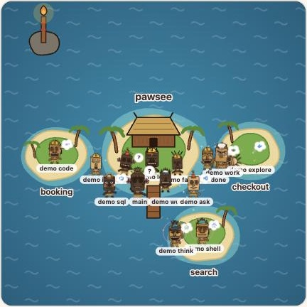<br><b>Tiki</b><br><sub>islands round a longhouse</sub></td><td align="center" width="25%">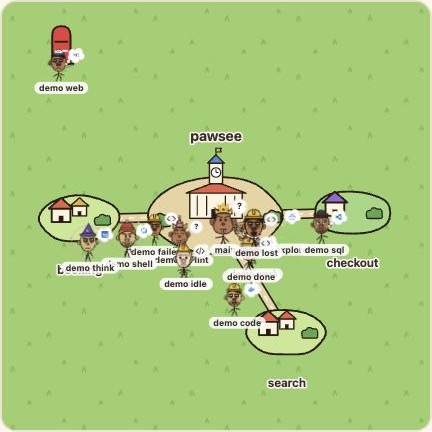<br><b>Cel</b><br><sub>hills with cottages round a town hall with a clock</sub></td><td align="center" width="25%">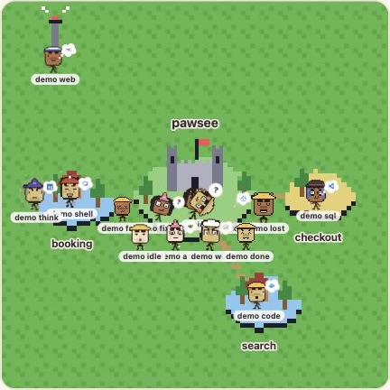<br><b>Pixel</b><br><sub>blocks of land round a little castle</sub></td><td align="center" width="25%">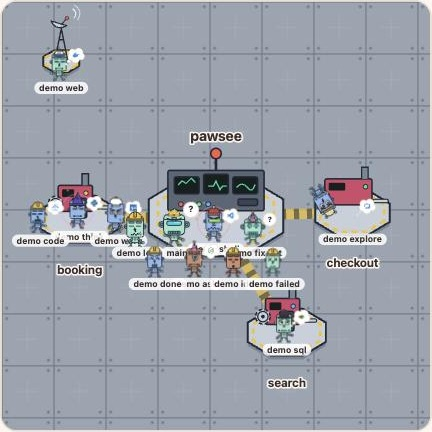<br><b>Robots</b><br><sub>machines on steel pads round the control room</sub></td></tr>
<tr><td align="center" width="25%">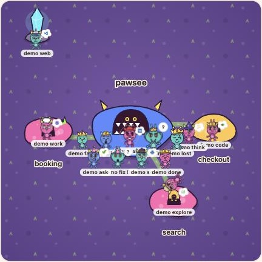<br><b>Monsters</b><br><sub>hills with caves round a toothy lair</sub></td><td align="center" width="25%">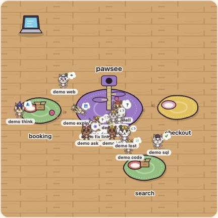<br><b>Cats</b><br><sub>rugs with cat beds round a cat tree</sub></td><td align="center" width="25%">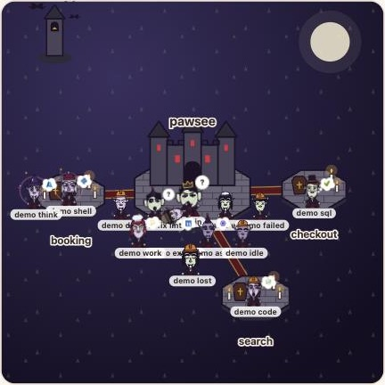<br><b>Vampires</b><br><sub>candlelit courtyards with coffins round the castle keep</sub></td><td align="center" width="25%">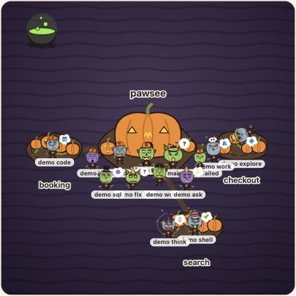<br><b>Halloween</b><br><sub>pumpkin patches round a jack-o'-lantern house</sub></td></tr>
<tr><td align="center" width="25%">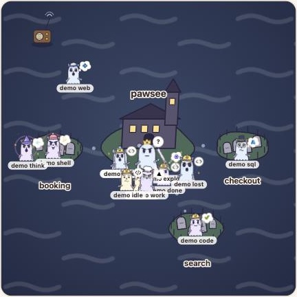<br><b>Ghosts</b><br><sub>churchyard plots round a haunted mansion</sub></td><td align="center" width="25%">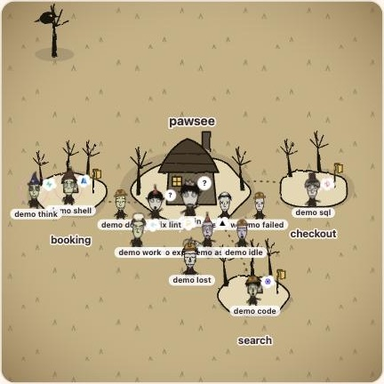<br><b>Inkwell</b><br><sub>camps among bare trees round a crooked cottage</sub></td><td align="center" width="25%">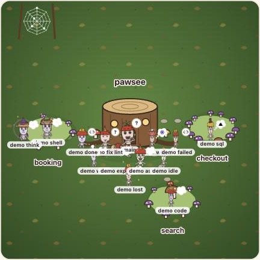<br><b>Mushroom folk</b><br><sub>fairy rings round a tree stump</sub></td><td align="center" width="25%">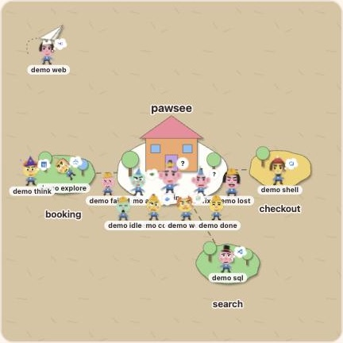<br><b>Paper cutouts</b><br><sub>torn paper patches round a pop-up house</sub></td></tr>
<tr><td align="center" width="25%">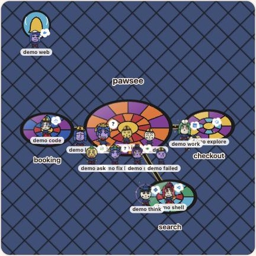<br><b>Stained glass</b><br><sub>small rose windows round the great rose window</sub></td><td align="center" width="25%">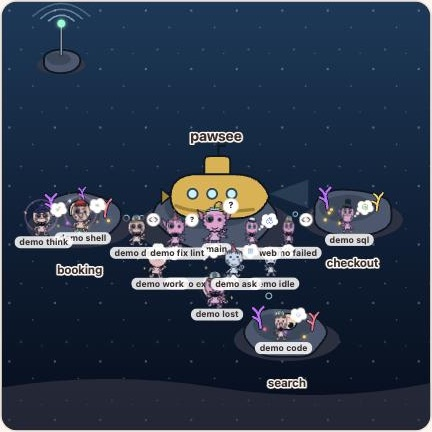<br><b>Deep sea</b><br><sub>coral reefs round a submarine</sub></td><td align="center" width="25%">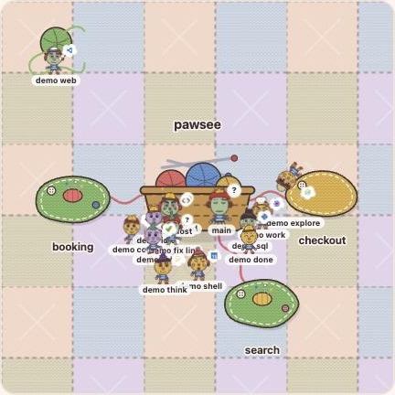<br><b>Knitted</b><br><sub>felt patches on a quilt round a sewing basket</sub></td><td align="center" width="25%">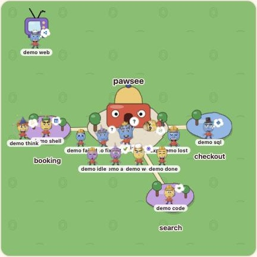<br><b>Claymation</b><br><sub>clay hills round a squashy town hall</sub></td></tr>
</table>

| Style | Places | Home | Ways | The web |
|---|---|---|---|---|
| `cel` | hills with cottages | town hall with a clock | country roads | the post box |
| `pixel` | blocks of land | a little castle | dirt tiles | a signal tower |
| `robot` | machines on steel pads | the control room | floor lanes | a radio mast |
| `monsters` | hills with caves | a toothy lair | slime trails | a glowing crystal |
| `cats` | rugs with cat beds | a cat tree | paw prints | a laptop |
| `vampires` | candlelit courtyards with coffins | the castle keep | red carpets | a belfry of bats |
| `halloween` | pumpkin patches | a jack-o'-lantern house | dirt tracks | a bubbling cauldron |
| `ghosts` | churchyard plots | a haunted mansion | floating wisps | an old wireless |
| `inkwell` | camps among bare trees | a crooked cottage | dotted footpaths | a raven |
| `mushrooms` | fairy rings | a tree stump | stepping stones | a dewy spider's web |
| `paper` | torn paper patches | a pop-up house | "cut here" lines | a paper aeroplane |
| `glass` | small rose windows | the great rose window | bands of lead | a bell |
| `deepsea` | coral reefs | a submarine | bubble trails | a sonar beacon |
| `knitted` | felt patches on a quilt | a sewing basket | strands of yarn | a tangled ball of yarn |
| `clay` | clay hills | a squashy town hall | rolled clay snakes | a clay telly |

The parts of a codebase come from the files the agents touch: an Nx lib (or its `scope:` tag), a .NET project (`Acme.Booking.Api` is *Booking*), a React page or feature folder, a Django app or Python package, or else the first folder that isn't `src`, `lib` or `app`. The same name shows as a 📍 pill on the card. A map is one repo's world, so it shows one repo at a time (the busiest, or the one you pick above the map); the cards show them all. A style gets a map by adding a `map` kit next to its faces; what a kit draws is described at the top of `public/faces.js`. A new style without a kit greys the Map button out and shows the cards.

Agents have moods too: sleepy-eyed just after napping off and deeply asleep (slow breathing, extra z's) after two minutes, worried (sweat drops) when an attempt fails, and dizzy (spiral eyes, circling stars) after lots of failed attempts in a row.
When an agent that was running finishes, it does a happy jump with confetti; when it fails, it flops over.
Sounds are off by default: click the "Sound off" button next to the version to switch on a soft chime when something needs you and another when the last working agent finishes (made in the browser, no audio files). They are off again every time you refresh the page.
While the tab is in the background, the tab icon gets an amber count when something needs you (and the title flashes), or a green tick when work finished while you were away.

The paw in the corner of each card tells you which tool an agent belongs to (claws for Claude Code, round beans for Copilot CLI) at a glance.

Each card also shows the AI credits (AIC) that agent has used, and the header shows the session total (Copilot CLI only: Claude Code doesn't log credits).
Claude Code has no approval prompts in its logs, so "needs you" appears there for `AskUserQuestion` only.
Agents left over from before your latest prompt in a session are hidden, so the page only shows the current task.
Add `?demo` to the URL to preview every state with sample data.

## Your own skill images

pawsee creates a folder at `~/.pawsee/logos` (change it with `--logos <path>` or `$PAWSEE_LOGOS`). Drop an image in it named after a skill,
for example `nx.png`, `my-deploy-skill.svg` or `ado.webp` (png, jpg, webp, gif or svg). When an agent uses that skill, the image appears in
its thought bubble. Names are matched case-insensitively with dashes for anything else, and `plugin:skill` also matches `skill`.
The same name also matches an MCP tool prefix (`github-…`) or a command (`terraform`), and your image wins over the built-in logos.
New files are picked up without restarting. Square images with a transparent or white background look best.

## Development

```bash
npm test   # unit tests plus end-to-end tests that run the server against fake Copilot and Claude Code logs
```

`npm run dev` restarts on every change and serves on **4748** (without opening a tab), so it never collides with a normal `pawsee` / `npx @horrible73/pawsee` run on 4747.

## Notes

- If a log format changes under it, pawsee shows a red notice at the top ("can't make sense of some logs") instead of quietly showing fewer agents. It appears when a session has lines that won't parse, or a long session where nothing was recognised. Please [open an issue](https://github.com/henskjold73/pawsee/issues) with the CLI version you use.
- It relies on the internal log formats of Copilot CLI (tested with 1.0.105) and Claude Code (tested with 2.1.309), which could change in an update.
- Built for macOS, Windows and Linux by CI; only macOS has been tried by hand so far — issues welcome.

## Credits

The tool logos in the "thinking" bubble are the real ones, taken from [simple-icons](https://simpleicons.org) (CC0-1.0:
Git, GitHub, Nx, npm, .NET, Docker, SonarQube Cloud, Node.js, TypeScript, Python, Vitest, ESLint, Prettier, Firebase, Vercel, Netlify, Supabase, Prisma, Expo, Next.js, Vite, Tailwind CSS, Storybook, Cloudflare, Turborepo, Angular, React, Vue, Svelte, Astro, Bun, Deno) and
[devicon](https://devicon.dev) (MIT: Azure DevOps, Azure, Visual Studio Code, Playwright). The marks remain trademarks of their respective owners and are shown only to identify the tool an agent is using.

## License

MIT
